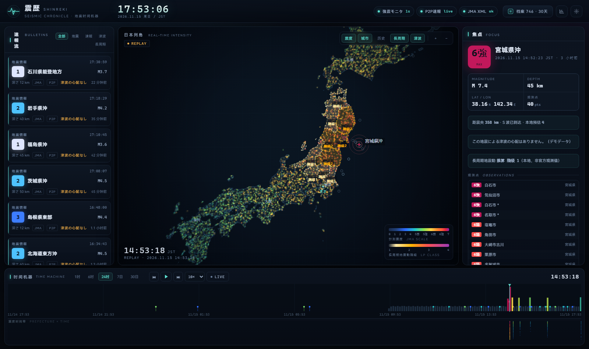
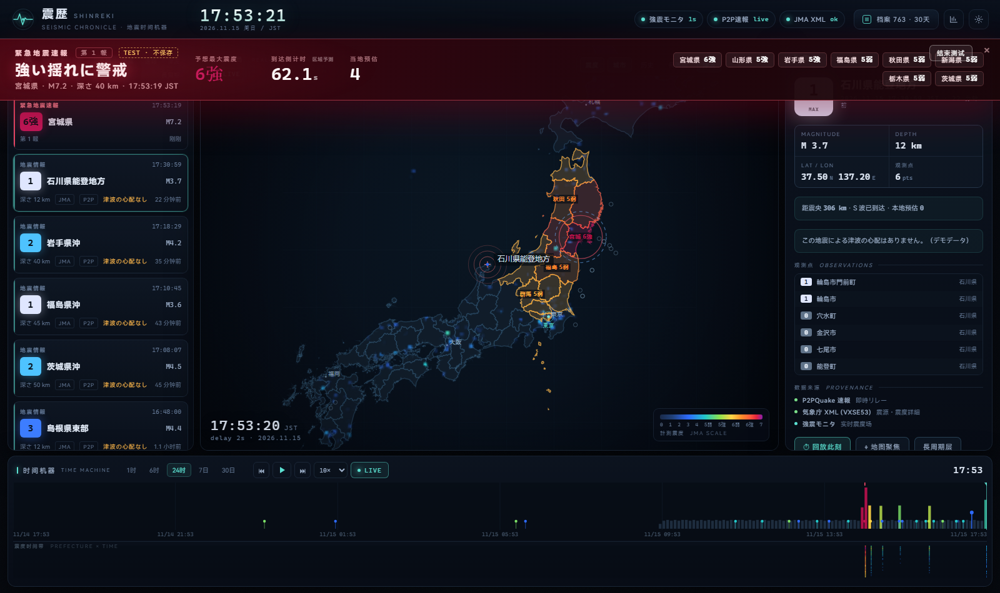
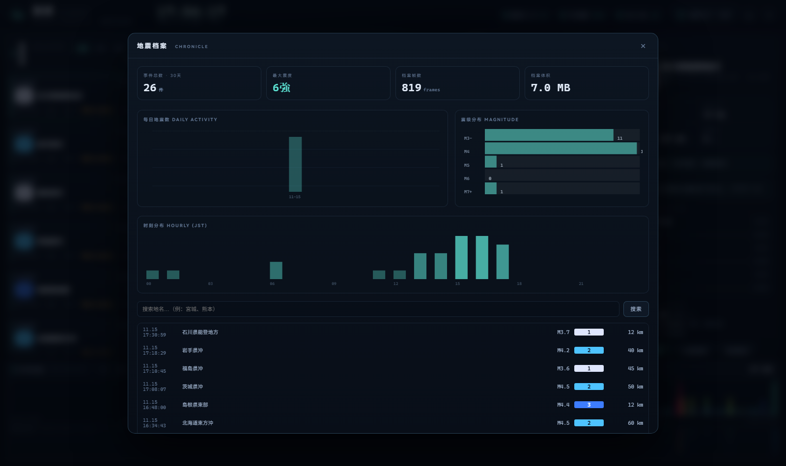
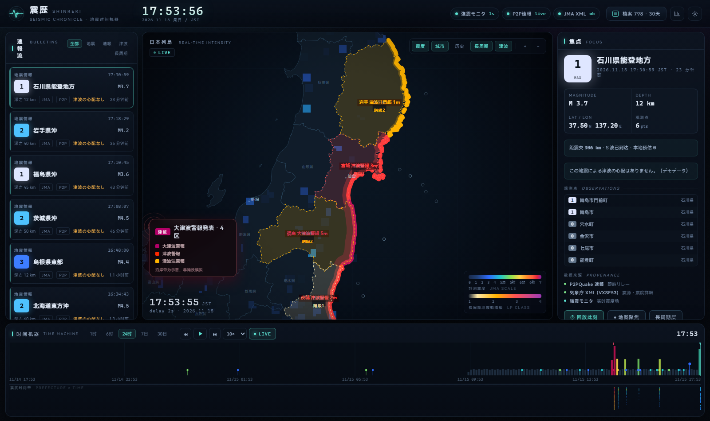
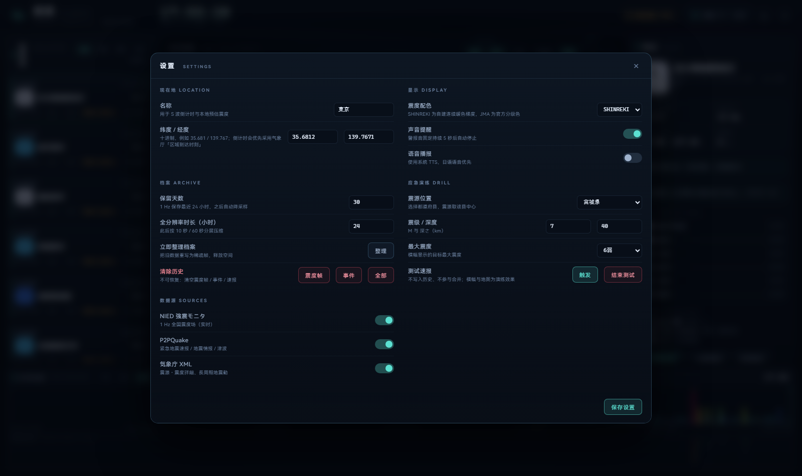
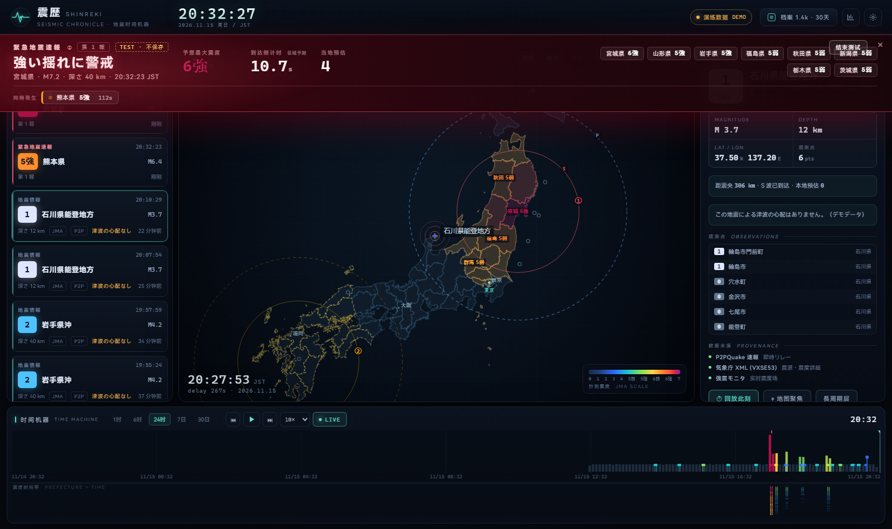

# 震歴 SHINREKI · 地震时间机器

> 以日本气象厅（JMA）公开的**紧急地震速报 / 地震情报 / 津波情报 / 長周期地震動**和 **NIED 強震モニタ** 实时震度场为数据源，
> 自己从零实现的桌面级地震监视与**长期档案回放**软件。
>
> 全部代码为本项目原创：**没有使用 JQuake 的任何闭源组件**；KyoshinEewViewer 只作为功能参照，
> 未复制其代码或资源。地图、配色、存储格式、回放引擎、警报音均由本项目自行设计与实现。
>
> **已打包为单文件 exe**（约 29 MB，免安装 Python，双击即用）：见 Releases，或运行 `build_exe.bat` 自行构建。



---

## 1. 它是什么

震歴把「现在正在发生什么」和「过去发生过什么」放在同一条时间轴上：

- **LIVE**：1 Hz 全国震度场 + 紧急地震速报 + 地震情报 + 津波，实时上屏。
- **REPLAY（时间机器）**：拖动底部时间轴，回到任意时刻，重放当时的震度场与速报。
- **ARCHIVE（地震档案）**：所有事件与震度帧写入本地 SQLite，默认保留 **30 天**，
  远超 JQuake 的 2 小时环形缓冲，并且可以自行改为 365 天。

### 与 JQuake / KyoshinEewViewer 的差别（本项目的“自己的特色”）

| | 震歴 SHINREKI | JQuake | KyoshinEewViewer |
|---|---|---|---|
| 历史长度 | **默认 30 天**，可配置到 10 年 | 约 2 小时环形缓冲 | 仅当前会话 + 少量事件 |
| 历史存储 | 自研**分层稀疏帧**（1 Hz → 10 s → 60 s 自动降采样） | 内存环形缓冲 | 内存为主 |
| 回放 | 时间轴拖动 + 变速播放（1×/10×/60×/300×） | 时间滑块 | 无 |
| 数据来源 | 同时接入 NIED 强震监测栅格、P2PQuake 速报、JMA XML，并在事件里标注**来源** | 自有 | 多个 |
| 到达倒计时 | 优先采用气象厅「区域到达时刻」，缺失时用分层走时模型，界面标注依据 | 有 | 有 |
| 长周期地震动 | 解析 JMA VXSE61/62 階級 + 本地推算层（虚线） | 无 | 有 |
| 津波沿岸 | 按警报等级绘制**海岸线淹没带**（示意）+ 预报区/最大波高 | 有 | 有 |
| 演练 | 可自定义震源/震级/深度/最大震度，**不写入历史**，可一键结束 | 无 | 无 |
| 档案统计 | 每日活动、震级分布、时刻分布、震度时间带 | 无 | 无 |
| 配色 | 自建连续震度色带（可切换 JMA 官方色） | 固定 | 可换主题 |
| 运行方式 | 纯 Python 标准库 HTTP 服务 + 原生 JS 前端，零 npm、零框架 | Java | C#/Avalonia |

---

## 2. 界面

| 紧急地震速报（含到达倒计时、预想震度、地区着色） | 地震档案与统计 |
|---|---|
|  |  |

| 长周期地震动 + 津波沿岸淹没带 | 设置 / 演练 |
|---|---|
|  |  |

界面分区：

- **顶栏**：JST 时钟、数据源健康灯（強震モニタ / P2P / JMA XML）、档案规模、设置。
- **左栏 速報流**：地震情報、緊急地震速報、津波情报卡片，按时间倒序，可筛选。
- **中栏 地图**：日本列岛矢量底图 + 实时震度场 + 震源 + P/S 波前 + EEW 预想区域着色 + 现在地。
- **右栏 焦点**：选中事件的震源参数、震度分布、观测点列表、数据来源、回放按钮。
- **底部 时间机器**：活动直方图、事件标记、可拖动播放头、1 时 / 6 时 / 24 时 / 7 日 / 30 日量程、
  震度时间带（都道府县 × 时间的热力图）。

地图右上的图层按钮：

| 图层 | 内容 |
|---|---|
| 震度 | 实时/回放震度栅格（可关闭只看地图） |
| 城市 | 主要城市标注 |
| 历史 | 近 24 小时震源小圈 |
| **長周期** | 长周期地震动階級着色（官方情报为实线，推算为虚线），并在图例中显示 1–4 階級色带 |
| **津波** | 按 大津波警報 / 津波警報 / 津波注意報 绘制海岸线淹没带：沿岸高亮线 + 向内陆渐隐的淹没带 + 流动虚线；标注最大波高；左下角显示警报图例 |

---

## 3.5 灾害图层与演练

### 3.5.1 到达倒计时与波前圈（同一套走时模型）

以前红圈按固定 4.0 km/s 画、倒计时按另一套算法，远距离时会差出几十秒。现在两者共用 `buildTravelModel()`：

1. 取出速报里所有带到达时刻的**预想区域**，用区域质心算出震央距，对 `t = a + b·√(d²+深度²)` 做最小二乘拟合；
2. 若「现在地」所在都道府县本身在区域列表里，再把拟合线**锚定**到该区域的气象厅到达时刻——
   于是倒计时读数与红圈半径在「现在地」这一点上严格一致；
3. 没有区域到达时刻时，退回分层走时（0–150 km 取 4.0 km/s，更远取 6.8 km/s），
   波前圈用同一条曲线的反函数，仍然一致；
4. 地图上的 **红圈 = S 波前、蓝虚线 = P 波前**（都带 P/S 字样），
   红圈在倒计时归零的瞬间正好经过「现在地」标记；
5. 到达后显示「已到达 Ns」，不再直接跳到 PASS。

界面上的「区域予測 / 推算」标签会告诉你当前用的是哪一种来源。

### 3.5.2 长周期地震动

- 后台轮询 `eqvol.xml` 与 `extra.xml`，解析 **VXSE61 / VXSE62** 的 `階級 1–4`（区域与观测点）；
- 有官方情报时优先显示官方层；没有时按 `2.0·M − 2.9·log10(R) − 6.4` 给出本地推算值，
  并明确标注「推算（非官方观测值）」；推算图层用虚线边框区分；
- 长周期情报也会作为「長周期地震動」卡片进入速报流。

### 3.5.3 津波海岸线淹没带

津波警报按预报区名称匹配到都道府县（含东京湾、相模湾等特殊名称），
再用预生成的海岸线段（由都道府县边界 × 陆地栅格求交得到）绘制：

- 颜色：大津波警報 紫红 / 津波警報 红 / 津波注意報 琥珀；
- 宽度随最大波高增大，并叠加向内陆渐隐的淹没带；
- 附「沿岸带为示意，非淹没模拟」提示，避免被误当作避难依据。

### 3.5.4 应急演练（不污染档案）

设置 → 应急演练：

- 选择**震源位置**（47 都道府县，取县中心）、**震级**、**深度**、**最大震度**；
- 「触发」后立即广播一条带 `TEST · 不保存` 标记的速报：横幅、地图着色、波前、倒计时全部可用；
- 该速报**不写入数据库、不参与双源合并**，仅存在于内存，300 秒后自动消失；
- 「结束测试」按钮（或横幅右上角的同名按钮）立即发出取消报并清除，警报音同时停止。

### 3.5.5 清除历史 / 清除速报

- 设置 → 档案 → 清除历史：可分别清除「震度帧」「事件」「全部」，二次确认后执行并 `VACUUM`；
- 速报横幅右上角 `×` 会把**当前主事件**加入「已忽略」集合并切换到下一条速报，
  不会把同时进行的其他速报一起关掉；警报音随 `×` 立即停止，且**最多只响 5 秒**。

### 3.5.6 同时发生两个（或多个）地震

**数据层**

- 速报按 `eventId + 报次` 分组，同一事件只显示最新报次，不同事件完全独立；
- 地震情报 key 改为**秒级**（`q-YYYYMMDDHHMMSS`），同一分钟内的两个地震不再互相覆盖；
- P2P 与 JMA XML 的双源合并窗口收紧为 **±20 秒 / 震央 ≤40 km / 震级差 ≤1.2**，
  避免把真正的「双震」误合并成一条；
- 同时进行的速报最多保留 6 条（含演练），按最大震度排序。

**界面**

- 横幅显示「主事件」（按 最大震度 → 到达时间 排序），下方「同時発生」列出其余速报及各自的到达倒计时；
- **主事件默认每 5 秒自动轮换**（设置里可选 5 / 10 / 15 秒或关闭）；
  点击某条速报会暂停轮换并固定该事件，横幅内的「⇄ 轮换 5s」按钮可随时暂停 / 恢复；
- 地图：主事件实心着色 + 红色 S 波前；其余事件用各自颜色（②橙、③蓝）画**虚线县界 + 虚线圈**，
  环上标注 ①②③；轮换时地图的强调色与波前也随之切换；
- 每条新速报各响一次 5 秒警报；同一批收到多条时提示「同时收到 N 条紧急地震速报」；
- 速报流里每条速报都是独立卡片，点 EEW 卡片会把它切换为主事件。

**编号规则（固定不变）**

- 同时进行的速报按**发生顺序**编号：先发生的 ①，其次 ②、③……
- 发震时刻**完全相同**时，按**震级从大到小**排；
- 若仍相同，按事件 ID 的哈希排序——等价于随机，但刷新、轮换后都不会变；
- 编号与颜色（①红 / ②琥珀 / ③蓝 / ④紫）一旦分配就固定：轮换主事件、状态刷新、报次更新都不改号；
- 当所有速报都结束后编号归零，下一次地震重新从 ① 开始；
- 编号会显示在横幅、同时发生条、地图波前圈和速报卡片上。

**演练**

- 设置 → 应急演练 → **双震**：同时触发宮城県 M7.2 与熊本県 M6.4 两条测试速报（不写入历史）。



上图：① 宮城県（主事件，实心着色 + 红色 S 波前），② 熊本県（虚线县界 + 琥珀色波前圈），
横幅下方「同時発生」实时显示第二条速报的倒计时，点击即可切换主事件。

---

## 3. 快速开始

### 方式 A：单文件 exe（推荐）

从本仓库的 **Releases** 下载 `Shinreki.exe`，双击即可；也可以自行打包：

```bat
build_exe.bat
```

双击 exe 后会：自动启动本地服务（默认 8787，被占用自动顺延），并以 Edge/Chrome 应用窗口打开界面。
数据目录为 `%LOCALAPPDATA%\Shinreki\`（`archive.db`、`settings.json`、`shinreki.log`），
与 exe 放在哪里无关，升级 exe 不会丢历史。

命令行参数（可选）：`--port 9000`、`--demo`（演练数据）、`--no-sources`（离线）、`--open`（用默认浏览器）。

### 方式 B：源码运行

要求：Windows 10/11，Python 3.10+（打包需 3.11+），能访问
`www.kmoni.bosai.go.jp`、`api.p2pquake.net`、`www.data.jma.go.jp`。

```bat
pip install -r requirements.txt
python -m app --app-window      :: 应用窗口
python -m app --open            :: 默认浏览器打开
python -m app --demo --open     :: 生成 8 小时演练数据后启动（不联网）
```

- 默认地址 `http://127.0.0.1:8787/`，端口被占用时会自动顺延。
- 数据目录：`data/`（`archive.db`、`settings.json`、`shinreki.log`）。
- 想换数据目录：设置环境变量 `SHINREKI_DATA=...`。
- 无窗口启动：双击 `run-silent.vbs`（需要 `pythonw`）。

### 重新打包 exe

```bat
build_exe.bat
```

等价于 `PyInstaller --onefile --windowed --add-data "web;web" --add-data "app/assets;app/assets" shinreki.py`。
注意：**Python 3.10.0 的 `dis` 有已知 bug，会让 PyInstaller 在分析 Pillow 时崩溃**，
请使用 3.10.11+ / 3.11 / 3.12 构建（本项目的 exe 使用 3.12.14 构建）。

### 快捷键

| 键 | 作用 |
|---|---|
| `空格` | 播放 / 暂停时间机器 |
| `L` | 回到 LIVE |
| `←` / `→` | 上一个 / 下一个地震事件 |
| `Esc` | 关闭弹窗 |

---

## 4. 数据来源（均为公开、无需密钥）

| 数据 | 端点 | 用途 |
|---|---|---|
| NIED 強震モニタ（地表 250 m 栅格渲染图） | `www.kmoni.bosai.go.jp/data/map_img/RealTimeImg/jma_s/<YYYYMMDD>/<YYYYMMDDHHMMSS>.jma_s.gif` | 1 Hz 全国震度场（352×400，约 1.8 万格点） |
| NIED 震度色标 | `.../ScaleImg/nied_jma_s_w_scale.gif` | 反解像素颜色 → 0.1 级震度 |
| P2PQuake v2 WebSocket | `wss://api.p2pquake.net/v2/ws` | 556 紧急地震速报、551 地震情报、552 津波 |
| P2PQuake v2 REST（兜底轮询） | `https://api.p2pquake.net/v2/history?codes=...` | WebSocket 断线时补漏 |
| 気象庁 防災情報 XML | `https://www.data.jma.go.jp/developer/xml/feed/eqvol.xml`、`extra.xml` | 震源・震度詳細（VXSE53）、長周期地震動（VXSE61/62） |

事件会做**双源合并**：同一地震（发震时刻 ±70 s、震央距离 < 120 km）会把 P2P 与 JMA 的记录合并成一条，
保留两边的原始字段并在界面标注 `P2P` / `JMA` 来源。

> 数据版权归 NIED / 気象庁 / P2PQuake 各自主张者所有。本项目只读取公开数据用于本地展示，
> 不重分发原始数据；地震速报仅供个人参考，**不可用于防灾决策或商业告警服务**。

---

## 5. 架构

```
Shinreki/
├─ dist/                     打包输出目录（build 生成，不纳入仓库）
├─ shinreki.py               PyInstaller 入口
├─ build_exe.bat             一键重新打包
├─ run.bat / run-silent.vbs  源码方式启动
├─ app/                      Python 后端（只依赖标准库 + Pillow + numpy）
│  ├─ __main__.py            启动器（端口选择、应用窗口、--demo）
│  ├─ server.py              ThreadingHTTPServer：静态文件 + JSON API + SSE
│  ├─ state.py               装配、状态快照、二进制帧流、统计、演练速报
│  ├─ kmoni.py               1 Hz 震度场采集器（GIF → 0.1 级栅格）
│  ├─ p2pquake.py            WebSocket + 轮询，556/551/552 解析
│  ├─ jmaxml.py              JMA XML 拉取，VXSE53 震度 + VXSE61/62 长周期
│  ├─ events.py              事件规范化、去重、双源合并
│  ├─ store.py               SQLite 档案（K/D/S 三种帧 + 分层压缩 + 长周期/津波）
│  ├─ geo.py                 栅格投影、大圆距离、P/S 走时、都道府县质心
│  ├─ scale.py               震度码 / 标签 / 配色
│  ├─ wsclient.py            手写 RFC6455 客户端（不依赖 websockets）
│  ├─ demo.py                确定性演练数据生成
│  └─ assets/                legend.json、prefmap.bin、grid.json（构建产物）
├─ web/                      前端（原生 ES Module，无构建步骤）
│  ├─ app.css                仪器面板风格样式
│  ├─ js/map.js              Canvas 地图、震度位图、波前、津波沿岸带、长周期层
│  ├─ js/timeline.js         时间轴 + 震度时间带
│  ├─ js/panels.js           速报流 / 焦点 / 设置 / 档案
│  ├─ js/app.js              状态机、SSE、回放、倒计时、快捷键
│  └─ data/                  japan.json（简化边界）、prefmap.bin（陆地栅格）
├─ tools/                    离线构建与测试脚本
└─ data/                     源码模式下的运行时数据（自动创建）
```

### 5.1 震度栅格与投影

NIED 的实时震度图是 352×400 的调色板 GIF。本项目：

1. 用公开色标反解 GIF 调色板 → 每个像素一个 0.1 级震度值（255 = 无数据）；
2. 用都道府县边界与底图做 **IoU 拟合**，得到栅格的地理变换（`lon_c=137.28, lat_c=38.08, kx=20.24, ky=24.48`，
   拟合 IoU ≈ 0.90）；
3. 前端把栅格当作位图叠到自绘矢量地图上，因此可以任意缩放、着色、做历史回放。

### 5.2 档案格式（这是能“存很久”的关键）

| 类型 | 内容 | 用途 |
|---|---|---|
| `K` keyframe | 整幅 352×400 栅格，zlib | 每约 5 分钟一个，供随机定位 |
| `D` delta | 与上一帧的差异像素列表，zlib | 1 Hz 实时层，实测平均 **约 110–150 B/帧** |
| `S` sparse | 绝对亮像素列表，zlib | 归档层（10 s / 60 s 一帧），无需依赖前序帧 |

分层策略（可在设置里改）：

- 最近 **24 小时**：1 Hz 全分辨率；
- 24 小时 – 7 天：每 10 秒一帧；
- 7 天 – 保留期（默认 30 天）：每 60 秒一帧；
- 事件（地震、EEW、津波）**永久保留**，与帧的清理无关。

体积参考：1 Hz 层约 10 MB/天；含 30 天分层后总计约 60–120 MB（取决于地震活跃度）。
若把保留期改成 365 天，最老的部分仍只有 60 秒一帧，增长很慢。

### 5.3 实时链路

```
NIED GIF ──1 Hz──► 解码 ──► SQLite(K/D) ──► SSE "frame" ──► 浏览器增量拉取 /api/raster
P2P WS  ──即时──► 规范化 ──► 合并去重 ──► SQLite ──► SSE "quake"/"eew" ──► 横幅/声音/地图
JMA XML ─45 s──► VXSE53 ──► 合并（更详细的观测点）
```

浏览器端只保留一份 352×400 的 `Uint8Array` 震度栅格：LIVE 时每帧拉取一次 gzip 后的整幅数据（约 4–6 KB），
REPLAY 时按窗口请求二进制帧序列（`/api/frames`），在本地逐帧差分还原。

---

## 6. HTTP API

| 方法 | 路径 | 说明 |
|---|---|---|
| GET | `/api/state` | 全局快照（状态灯、最新帧、速报、档案规模、设置） |
| GET | `/api/stream` | SSE：`hello` `state` `frame` `quake` `eew` `tsunami` |
| GET | `/api/raster?ts=` | 指定时刻的整幅震度栅格（gzip 二进制，140800 B） |
| GET | `/api/frame?ts=&floor=` | 稀疏帧 JSON（用于悬浮查看） |
| GET | `/api/frames?from=&to=&step=` | 二进制帧序列（回放） |
| GET | `/api/events?from=&to=&limit=` | 事件列表 |
| GET | `/api/event/<key>` | 事件详情（含观测点 Top N） |
| GET | `/api/eews?from=&to=` | 紧急地震速报序列 |
| GET | `/api/timeline?from=&to=` | 直方图桶 + 事件 + 速报 |
| GET | `/api/heat?from=&to=` | 都道府县 × 时间的最大震度 |
| GET | `/api/longperiod?from=&to=` | 长周期地震动情报 |
| GET | `/api/stats?days=` | 档案统计 |
| GET | `/api/search?q=&min=` | 地名搜索 |
| POST | `/api/settings` | 保存设置（地点、配色、声音、保留期、数据源） |
| POST | `/api/compact` | 立即整理档案 |
| POST | `/api/clear` | 清除历史 `{target: all/frames/events}` |
| POST | `/api/demo` | 生成演练数据 |
| POST | `/api/demo/eew` | 触发测试速报（可传 `pref/mag/depth/maxi/lat/lon/place`，不落库） |
| POST | `/api/demo/eew/double` | 同时触发两条测试速报（双震演练） |
| POST | `/api/demo/eew/end` | 结束测试速报 |

---

## 7. 设置项

- **现在地**：名称、纬度、经度（用于 S 波倒计时和本地预估震度）。
- **震度配色**：`SHINREKI`（自建连续暖色梯度）/ `JMA 官方`（分级色）。
- **声音提醒 / 语音播报**：自合成警报音，**每次最多响 5 秒**；TTS 优先日语。
- **同时速报轮换**：多条速报时主横幅每 5 / 10 / 15 秒切换一次，可关闭。
- **保留天数**、**全分辨率时长**、立即整理、**清除历史**（帧 / 事件 / 全部）。
- **应急演练**：震源位置（都道府县）、震级、深度、最大震度、触发 / 结束测试（不写入历史）。
- **数据源开关**（強震モニタ / P2P / JMA XML）。

---

## 8. 已知限制

- 仅覆盖日本列岛（数据源本身的地理范围：约 128.6–146.0°E、29.9–46.3°N）。
- NIED 只提供最近约 3 小时的历史帧，因此**首次启动前的历史无法补全**；档案从你启动那一刻开始积累。
- 震度场是 NIED 公开图的像素反解，精度约 0.1 级、空间分辨率受原图限制；
  事件观测点数据来自 JMA/P2P，二者可能因速报/确定报不同而存在细微差异（界面保留双源以便对照）。
- 紧急地震速报为第三方转发（P2PQuake），存在数秒延迟，**不能替代 JMA 官方渠道**。
- 长周期地震动：官方情报只在达到发布标准的大地震后出现；其余情况显示的是**推算值**，不是观测。
- 津波「淹没带」是按预报区与波高绘制的**示意带**，不是数值模拟，也不代表实际浸水范围；
  请以自治体发布的避难信息与实际淹没预想图为唯一依据。
- 本项目不含任何商业地图服务，底图为公开 GeoJSON 简化数据，仅用于示意。

---

## 9. 开发者备注

```bat
:: 重新生成静态资源（简化边界、投影拟合、色标）
python tools/build_assets.py

:: 档案分层自测
python tools/test_archive.py
```

- `tools/calibrate_projection.py` 会重新下载 `japan.geojson` 并拟合栅格投影，输出 `tools/grid.json`；
  该脚本只需在更换底图时运行。

- 前端无打包步骤，改完 `web/` 后刷新即可。
- 后端线程：`kmoni`（1 Hz）、`p2p-ws`、`p2p-poll`、`jma-xml`、`maint`、`state`、HTTP 工作线程。
- 所有时间戳以 UTC 秒存储，界面统一显示 JST。

---

## 10. 许可与数据来源

- **代码**：MIT，见 [LICENSE](LICENSE)。
- **地图几何**（`web/data/japan.json`、`app/assets/prefmap.bin`、`tools/prefs_simplified.json`）：
  由 **地球地図日本（国土地理院）** 经 [dataofjapan/land](https://github.com/dataofjapan/land) 转换而来。
  非营利使用需注明出处；**营利使用需注明出处并向国土地理院提交利用报告**。
- **实时震度与色标**：防災科学技術研究所（NIED）強震モニタ。程序运行时读取公开图像，不重分发原始数据；
  `app/assets/legend.json` 仅为反解颜色用的 271 级色带采样。
- **速报 / 地震情报 / 津波 / 长周期**：P2PQuake 与気象庁 防災情報XML，遵循各自公开数据条款。

完整声明见 [NOTICE.md](NOTICE.md)。本项目与上述机构无隶属关系；地震速报存在延迟，
**不可用于防灾决策或商业告警服务**，使用本项目造成的一切后果由使用者自行承担。
